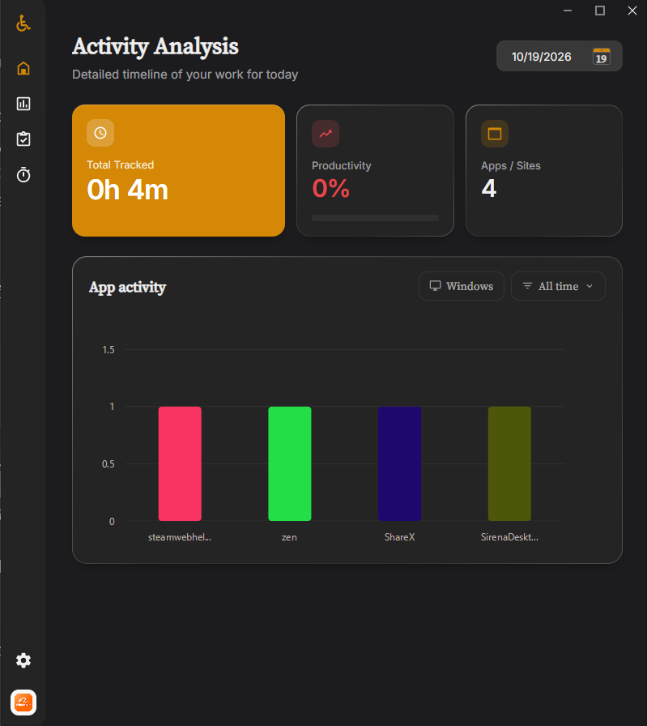
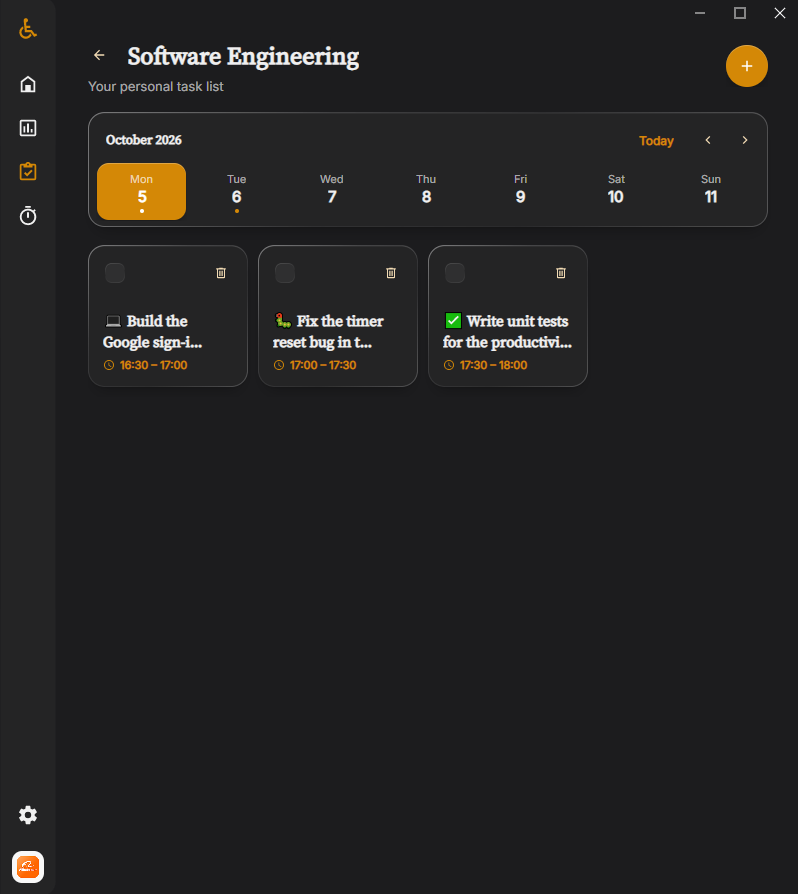
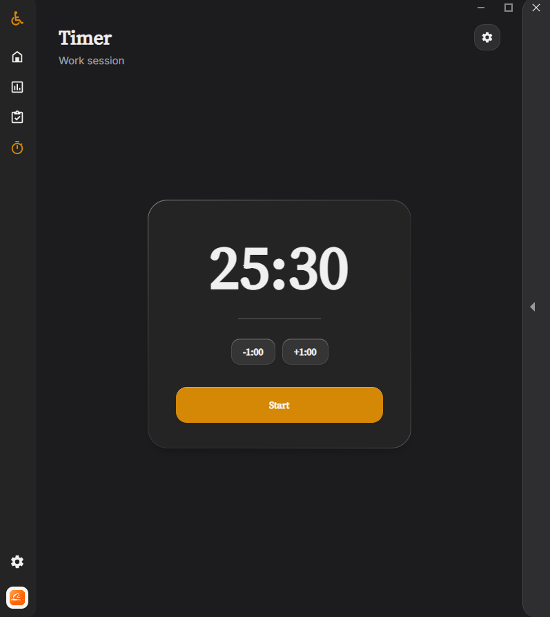
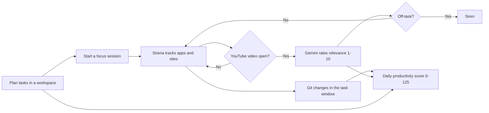
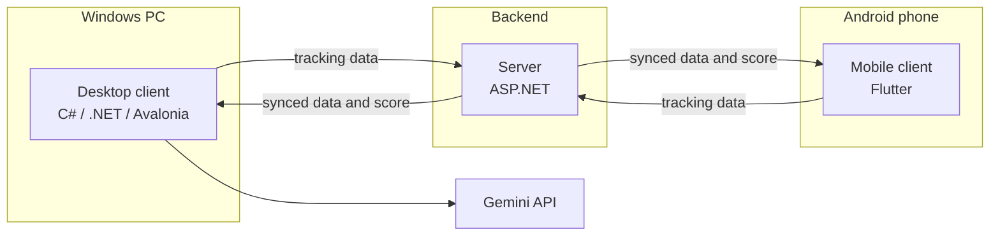

# Sirena

> **The productivity tracker that talks back.**

**Most productivity apps watch you fail quietly. Sirena sounds the alarm.**

Sirena combines a task workspace, a Pomodoro timer, activity analytics and an AI watchdog into one desktop app. When you drift into a pointless YouTube video during work time, Gemini notices and the siren goes off.

[](https://avaloniaui.net/)
[](https://github.com/XeonOnFire2666/Sirena/stargazers)
[](https://github.com/XeonOnFire2666/Sirena)
[](https://ai.google.dev/)

<p align="center">
  
</p>

<p align="center"><strong>Tasks · Analytics · Pomodoro</strong></p>

<table>
<tr>
<td width="33%"></td>
<td width="33%"></td>
<td width="33%"></td>
</tr>
<tr>
<td align="center"><em>Workspaces and daily tasks</em></td>
<td align="center"><em>Activity analysis and productivity score</em></td>
<td align="center"><em>Focus timer</em></td>
</tr>
</table>

## The Problem

You sit down for a focused block of work. You open YouTube "just for one tutorial". Forty minutes later you are watching something unrelated, your task list is untouched, and the only record of the afternoon is a vague feeling of guilt.

Most productivity tools fail here for the same reason: they are **passive**. They log time, draw a chart, and show it to you after the damage is done. A to-do app does not know you are procrastinating. A timer does not know what you are doing. A time tracker does not know whether the video you watched was a tutorial or a rabbit hole.

Sirena closes that gap. It connects the three things that normally live in separate apps, and it **intervenes in the moment** instead of reporting afterwards.

| | Typical task app | Typical time tracker | Sirena |
|---|---|---|---|
| Task list | ✓ | ✗ | ✓ |
| Pomodoro timer | Sometimes | ✗ | ✓ |
| Tracks the apps and sites you use | ✗ | ✓ | ✓ |
| Judges whether the content was useful | ✗ | ✗ | ✓ (Gemini) |
| Reacts in real time | ✗ | ✗ | ✓ (siren) |
| Single score that reflects your day | ✗ | ✗ | ✓ (0–125) |
| Uses your actual code output as a signal | ✗ | ✗ | ✓ (Git) |

## Core Features

### 1. AI Siren

Sirena watches what you are doing while a task is active. When you are watching a YouTube video, the title and context are sent to **Gemini**, which decides whether the content supports your current task. If you are stuck on something that does not, the siren plays.

Watching a conference talk about the library you are using is fine. Watching a compilation of random clips during a task slot is not.

**Bring your own key.** Sirena does not ship with an API key. You provide your own Gemini API key in Settings, so you control your usage and your quota.

### 2. Activity Analytics

A clear chart shows which apps and sites you spent time in while working on your tasks. Filter by platform and by time range to see where the day actually went.

- Total tracked time
- Number of distinct apps and sites
- Per-app activity breakdown
- Daily view with a date picker
- Tracking from both your PC and your Android phone, synced through your account

### 3. Productivity Score (0–125)

One number summarizes your day. It ranges from **0 to 125**, so an exceptional day can exceed 100%.

| Factor | What it measures |
|---|---|
| **Task completion ratio** | How many of your planned tasks you closed versus left open |
| **Completion speed** | How fast or slow you closed each task relative to its planned slot |
| **Content quality** | Each YouTube video you watched is rated from 1 to 10. Useful content raises the score, junk content lowers it |
| **Git activity** | In the Software Engineering workspace, changes in your local repositories during the task period add a bonus |

The score rewards finishing work, finishing it on time, consuming useful content, and shipping real changes.

### 4. Workspaces and Tasks

Organize work into workspaces and plan each day with timed task cards. Pick the **Software Engineering** workspace and Sirena starts tracking your local Git repositories, so the commits and changes you make during a task become part of your score.

### 5. Built-in Pomodoro Timer

A focus timer sits next to your tasks, not in a separate app. Start a session, work, pause when needed, reset when you must.

## How It Works



## Use Cases

**Developers who lose hours to "research".** Plan a Software Engineering block, start the timer, and let Sirena keep you honest. Your commits count in your favor, and so does the tutorial that actually helped.

**Students and self-learners.** Separate study videos from entertainment automatically instead of relying on willpower.

**Freelancers and remote workers.** Get an objective daily score and an app breakdown that shows where billable time really went.

**Anyone who has tried a productivity app and quit.** Sirena is built around active feedback, because passive dashboards are easy to ignore.

## Getting Started

Sirena is currently distributed as source. Prebuilt installers are planned.

**Requirements**

- Windows 10 or 11
- [.NET SDK](https://dotnet.microsoft.com/download)
- A Gemini API key from [Google AI Studio](https://aistudio.google.com/apikey)

**Run it**

```bash
git clone https://github.com/XeonOnFire2666/Sirena.git
cd Sirena
dotnet restore SirenaDesktop.sln
dotnet run --project SirenaDesktop.Avalonia
```

**First launch**

1. Open **Settings** and paste your Gemini API key
2. Create a workspace and add your tasks for the day
3. Start a focus session and get to work

## System Architecture

Sirena is not a single desktop executable. It is a distributed system of three cooperating parts, each built with the technology that fits its job best.



| Component | Technology | Role |
|---|---|---|
| **Desktop client** | C#, .NET, Avalonia UI | The core experience: task workspaces, Pomodoro timer, app and site tracking on Windows, Git analysis, Gemini-powered siren and the productivity score display |
| **Mobile client** | Flutter (Android) | Tracks activity on the phone, sends it to the server and shows your synced data and statistics |
| **Server** | ASP.NET | Handles accounts and authentication, stores the data behind the productivity score and synchronizes it between all clients |
| **Gemini API** | Google AI | Evaluates video content for relevance. Uses a key supplied by the user |

Keeping three clients and a server in sync, while the desktop client performs real-time tracking and AI evaluation locally, is the hard part of the project. It is also what lets Sirena behave like one product across devices instead of three disconnected tools.

## Tech Stack

| Layer | Technology |
|---|---|
| Desktop client | C# on .NET with [Avalonia UI](https://avaloniaui.net/) |
| Mobile client | Flutter (Android) |
| Server | ASP.NET |
| AI | Google Gemini API |
| Activity tracking | Windows-specific infrastructure (active window and browser tab monitoring) |
| Version control signal | Local Git repository analysis |

### Desktop Client Architecture

The desktop client follows a layered, clean-architecture style so that platform-specific code stays isolated from the business logic.

| Project | Responsibility |
|---|---|
| `SirenaDesktop.Core` | Domain models and rules: tasks, workspaces, productivity score |
| `SirenaDesktop.Application` | Use cases and orchestration |
| `SirenaDesktop.Infrastructure` | Cross-platform services: Gemini client, persistence, Git analysis |
| `SirenaDesktop.Infrastructure.Windows` | Windows-only services: active window and app tracking |
| `SirenaDesktop.Presentation` | View models and presentation logic |
| `SirenaDesktop.Avalonia` | Application entry point, Avalonia views and styling |

Because the UI layer is Avalonia and everything platform-specific lives in its own project, a macOS or Linux tracker can be added without touching the core.

## Contributing

Bug reports, ideas and pull requests are welcome on [GitHub Issues](https://github.com/XeonOnFire2666/Sirena/issues).

## License

No License yet.

---

If Sirena keeps you focused, please [give it a star on GitHub](https://github.com/XeonOnFire2666/Sirena). It helps other people find it.